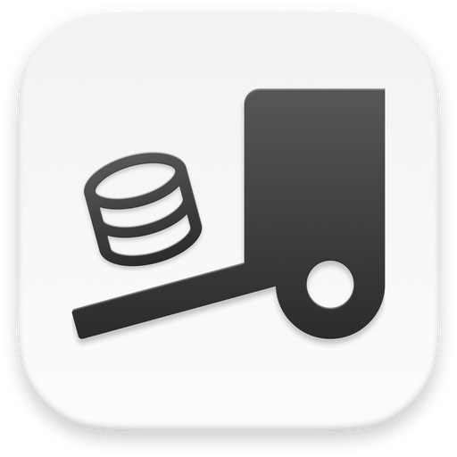

#  Dump Truck

App desktop para exportar, importar e copiar bancos MySQL/MariaDB com controle por tabela.

## O que faz

O Dump Truck conecta a servidores MySQL/MariaDB e facilita o trabalho com dumps:

- **Conexões favoritas** — salve hosts e acompanhe se estão online
- **Explorar bancos** — liste databases e tabelas com tamanho estimado
- **Exportar (.sql)** — gere dumps com `mysqldump`, escolhendo quais tabelas incluir e se exporta estrutura, dados e/ou `DROP`
- **Importar** — restaure um arquivo `.sql` em um database
- **Copiar entre conexões** — transfira tabelas de um servidor/database para outro, com progresso

Regras de exclusão (por sufixo, prefixo etc.) permitem pular tabelas ou partes do dump de forma consistente.

## Requisitos

- [Node.js](https://nodejs.org/) e npm
- [Rust](https://www.rust-lang.org/) (para builds Tauri)
- Cliente MySQL/MariaDB no `PATH` (`mysqldump` e `mysql`)

## Desenvolvimento

```bash
npm install
npm run tauri dev
```

## Build

```bash
npm run tauri build
```

## Stack

- [Tauri 2](https://tauri.app/) + Rust
- Vue 3 + Vite + Pinia
